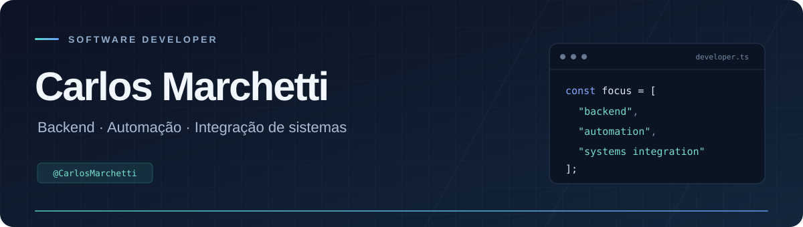

  

  
  &nbsp;
  

## Sobre

Sou **Carlos Marchetti**, desenvolvedor de software com foco em **backend, automação e integração de sistemas**. Trabalho com aplicações web, serviços e ferramentas que conectam diferentes tecnologias, do Node.js à integração entre Java e código nativo.

Também me dedico à engenharia reversa e à análise de software, com interesse em arquitetura, bytecode JVM e funcionamento de sistemas.

 

<table>
<tr>
<td width="33%" valign="top">

### Backend

APIs, serviços assíncronos e persistência de dados.

**Node.js · Express · Axum · Tokio**

</td>
<td width="33%" valign="top">

### Automação

Integração de fluxos, navegação programática e extração de dados.

**Python · Playwright · TypeScript**

</td>
<td width="33%" valign="top">

### Sistemas

Integração nativa, análise estática e manipulação de bytecode.

**Java · C++ · JNI · ASM**

</td>
</tr>
</table>

## Tecnologias

**Linguagens**

  
  
  
  
  

**Backend &amp; dados**

  
  
  
  

**Ferramentas**

  
  
  

---

  <b>Vamos conversar?</b> 
  Desenvolvimento de software, colaborações e contato profissional.  
  <a href="mailto:cmarchetti.dev@gmail.com">cmarchetti.dev@gmail.com</a>

