<div align="center">


[](https://github.com/CarlosMarchetti)

[](https://github.com/CarlosMarchetti)
[](mailto:cmarchetti.dev@gmail.com)
[](https://github.com/CarlosMarchetti)



</div>

---

## Sobre

```text
Nome:    Carlos Marchetti
Foco:    Engenharia Reversa • Segurança • Backend • Minecraft
Stack:   Java • C++ • C# • Rust • Go • Python • TypeScript
```

Desenvolvedor focado em entender como sistemas funcionam por dentro, do bytecode JVM a executáveis nativos, e transformar esse conhecimento em ferramentas reais. Também desenvolvo profissionalmente para Minecraft: plugins server-side, mods client-side, manipulação de protocolo e frameworks de bots.

**Estudando agora:** transformação de bytecode com ASM · formato PE e Windows Internals · disassembly e Control Flow Graphs · análise de malware em laboratório controlado.

---

## Destaques

<table>
<tr>
<td width="50%" valign="top">

### [Unveil](https://github.com/CarlosMarchetti/Unveil)

Framework modular de análise estática e desofuscação para JVM e binários PE. Recupera strings, simplifica bytecode, sugere nomes e gera relatórios versionados sem executar o alvo.

`Python` `Java` `ASM` `PE` `Static Analysis`

</td>
<td width="50%" valign="top">

### [IntelliScraper](https://github.com/CarlosMarchetti/IntelliScraper)

Automação de navegador com Playwright e proteções anti-detecção integradas. Zero configuração para começar.

`Python` `Playwright` `Automation` `Web Scraping`

</td>
</tr>
</table>

---

## Tecnologias

**Linguagens**&nbsp;&nbsp;


**Backend**&nbsp;&nbsp;


**Desktop e automação**&nbsp;&nbsp;


**Ferramentas**&nbsp;&nbsp;


---

## Estatísticas

<div align="center">

[](https://github.com/CarlosMarchetti)
[](https://github.com/CarlosMarchetti)

[](https://github.com/CarlosMarchetti)

</div>

---

<details>
<summary><b>English version</b></summary>

### About

```text
Name:    Carlos Marchetti
Focus:   Reverse Engineering • Security • Backend • Minecraft
Stack:   Java • C++ • C# • Rust • Go • Python • TypeScript
```

Developer focused on understanding how systems work from the inside, from JVM bytecode to native executables, and turning that knowledge into real tools. I also build for Minecraft professionally: server-side plugins, client-side mods, protocol manipulation and bot frameworks.

**Currently studying:** bytecode transformation with ASM · PE format and Windows Internals · disassembly and Control Flow Graphs · malware analysis in a controlled lab.

### Featured

- **[Unveil](https://github.com/CarlosMarchetti/Unveil)**: modular static analysis and deobfuscation framework for JVM and PE binaries.
- **[IntelliScraper](https://github.com/CarlosMarchetti/IntelliScraper)**: Playwright browser automation with built-in anti-detection.

</details>

<div align="center">


</div>
